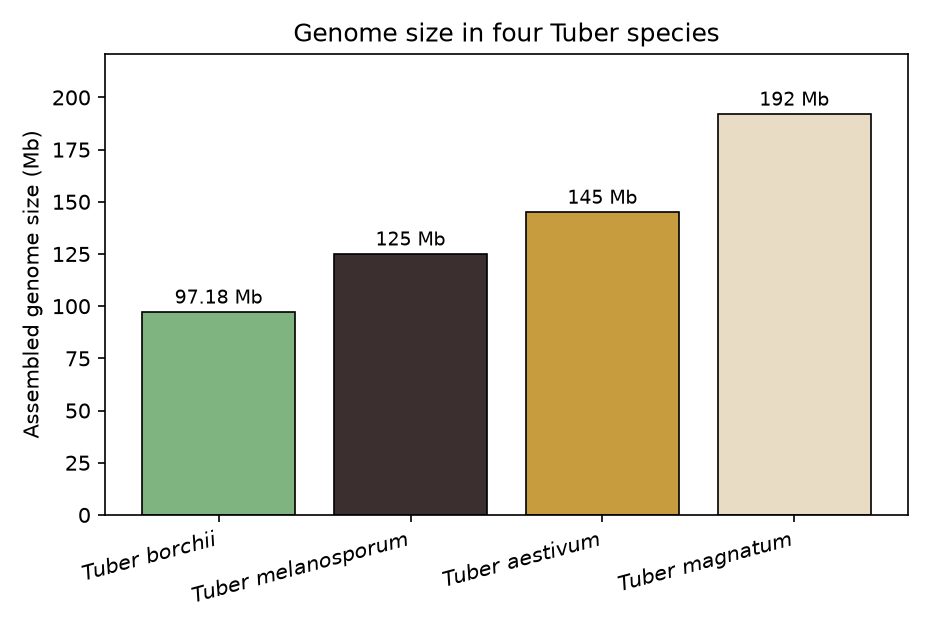
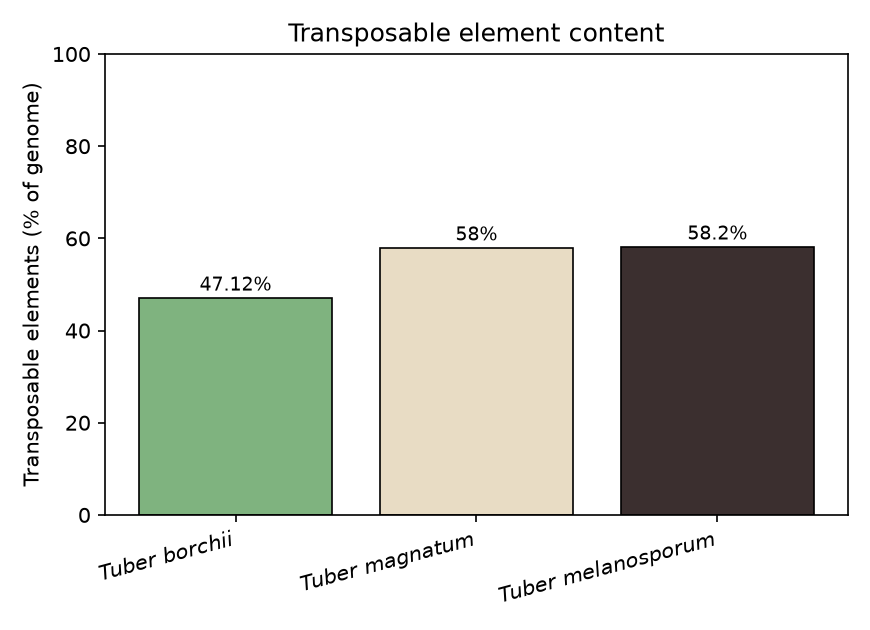
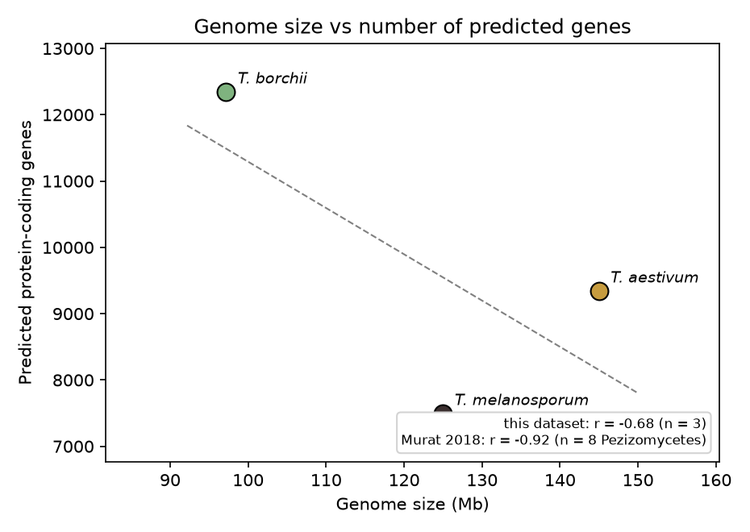
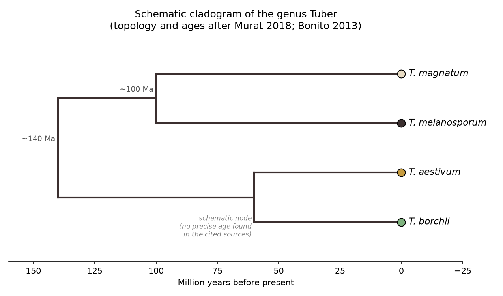
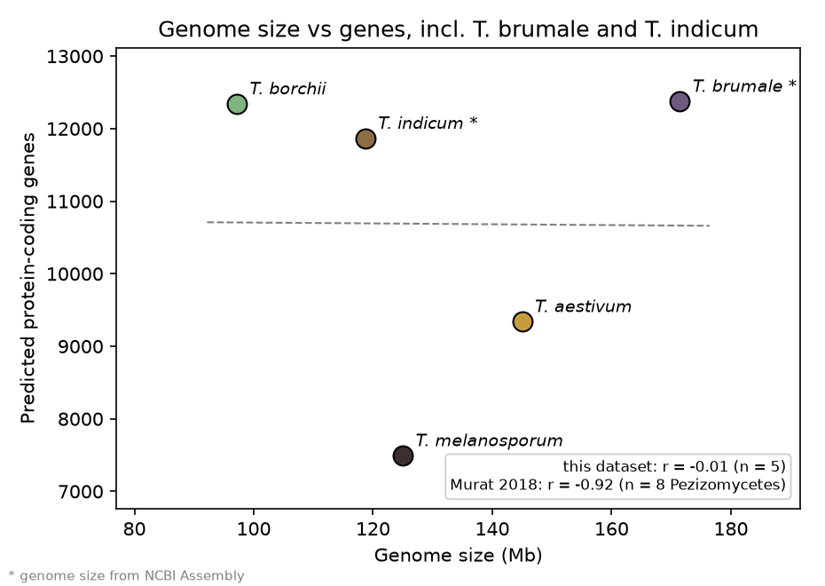

# Comparative Genomics and Phylogeny of the Périgord Black Truffle (*Tuber melanosporum*)

A reproducible bioinformatics pipeline comparing four sequenced *Tuber* genomes (*T. melanosporum*, *T. borchii*, *T. aestivum*, *T. magnatum*) and reconstructing the genus phylogeny from GenBank marker sequences.

📄 **Report:** [`report/Comparative_Genomics_Phylogeny_Tuber_melanosporum_EN.pdf`](report/Comparative_Genomics_Phylogeny_Tuber_melanosporum_EN.pdf)
📓 **Run it in Colab:** [open the notebook](https://colab.research.google.com/github/moudi-eng/tuber-comparative-genomics/blob/main/notebooks/tuber_pipeline.ipynb) and choose **Runtime → Run all**

## What the pipeline does

| Step | What it does | Output |
|---|---|---|
| `comparative` | Genome size, gene number, TE content, CAZyme range and the published cladogram, from a dataset where **every value is linked to its source** ([`data/verified_sources.json`](data/verified_sources.json)) | Tables 1–2, Figures 1–5 of the report |
| `ncbi` | Checks literature genome sizes against **NCBI Assembly** and adds *T. brumale* and *T. indicum* | Cross-check table, Figure 6 |
| `phylogeny` | Builds a **de novo phylogeny**: downloads ITS (or LSU / RPB2 / EF1α) sequences from GenBank, aligns them with **MAFFT**, removes gap-rich columns and infers a maximum-likelihood tree with **IQ-TREE 2** (ModelFinder + 1000 ultrafast bootstraps). It then compares the tree with the published topology. | Tree, distance heatmap, monophyly and topology checks |

The report could only redraw the published phylogeny, because NCBI wasn't reachable from its environment. The `phylogeny` step does the reconstruction the report lists as future work.

## Results

### Comparative genomics (literature-sourced, report Table 1)

| Species | Size (Mb) | Predicted genes | TE (%) | Source |
|---|---|---|---|---|
| *T. melanosporum* | 125 | 7,496 | 58.2 | Martin et al. 2010 |
| *T. borchii* | 97.18 | 12,346 | 47.12 | Iotti et al. 2018 |
| *T. aestivum* | 145 | 9,344 | n.s. | Murat et al. 2018 |
| *T. magnatum* | 192 | n.s. | 58 | Murat et al. 2018 |

| | |
|---|---|
|  |  |
|  |  |

### NCBI Assembly cross-check

| Species | Literature (Mb) | NCBI Assembly | NCBI (Mb) | Difference |
|---|---|---|---|---|
| *T. melanosporum* | 125 | GCF_000151645.1 | 124.95 | −0.04% |
| *T. borchii* | 97.18 | GCA_003070745.1 | 97.18 | 0.00% |
| *T. aestivum* | 145 | GCA_900010015.1 | 144.72 | −0.19% |
| *T. magnatum* | 192 | GCA_003182015.1 | 192.78 | +0.41% |
| *T. brumale* | n.s. | GCA_014065205.1 | 171.44 | n/a |
| *T. indicum* | n.s. | GCA_006112555.1 | 118.71 | n/a |

All four literature values agree with NCBI to within 0.5%.

Adding *T. brumale* and *T. indicum* (gene counts from Morin et al. 2020) removes the negative size–gene correlation within *Tuber*: r falls from −0.68 (n = 3) to −0.01 (n = 5). *T. brumale* combines a large genome with many genes. Murat et al.'s r = −0.92 was computed across 8 Pezizomycetes, not within one genus, and five points are too few for a firm conclusion either way.



### De novo ITS phylogeny

Run the notebook to produce `results/tuber/figures/fig7_ITS_tree.png` and the topology comparison. They aren't stored in the repository, because the ML tree should come from the MAFFT + IQ-TREE run on Colab.

## Quick start

```bash
pip install -r requirements.txt
sudo apt-get install mafft iqtree          # optional; without them the phylogeny uses neighbour-joining

python src/pipeline.py --config configs/tuber.json --email you@example.com
python src/pipeline.py --steps comparative                    # no internet needed
python src/pipeline.py --steps phylogeny --marker LSU --name tuber_lsu --email you@example.com
python src/pipeline.py --steps phylogeny --fasta my_seqs.fasta   # your own sequences (headers: Genus_species__id)
```

Edit [`configs/tuber.json`](configs/tuber.json) to change the species, outgroup, marker, number of sequences per species, gap-trimming threshold or bootstrap replicates. The pipeline works for any genus, not just *Tuber*.

## Method details

- **Sequence selection:** GenBank records whose organism matches exactly (no *cf.* or *aff.*), filtered by length. Records spanning the whole ITS1–5.8S–ITS2 region are preferred, then lengths closest to the median. Accessions are saved in `sequences_used.csv`.
- **Alignment:** `mafft --auto --adjustdirection`, which fixes reverse-complemented entries. Columns with more than 50% gaps are removed.
- **Tree:** IQ-TREE 2 with ModelFinder (`-m MFP`) and 1000 ultrafast bootstraps, rooted on *Choiromyces venosus*. FastTree is used if IQ-TREE is missing, and neighbour-joining if neither is installed.
- **Checks:**
  - whether each species and the genus *Tuber* are monophyletic
  - which taxa are closest to *T. melanosporum* by p-distance
  - Robinson–Foulds distance to the published cladogram

## Repository structure

```
├── configs/tuber.json            # species, outgroup, marker, parameters
├── data/verified_sources.json    # literature values, each with its source
├── src/
│   ├── pipeline.py               # entry point (CLI)
│   ├── config.py                 # configuration + sourced dataset loader
│   ├── comparative.py            # tables and figures 1-6, NCBI cross-check
│   ├── ncbi.py                   # Entrez: marker sequences + assembly statistics
│   └── phylogeny.py              # MAFFT, trimming, IQ-TREE / fallbacks, tree checks and plots
├── notebooks/tuber_pipeline.ipynb  # Colab notebook
├── results/tuber/                # tables and figures (comparative + NCBI)
└── report/                       # project report (PDF)
```

## Limitations

- **Literature values:** genome features come from published papers, not re-annotation. Values the sources don't give are left empty ("n.s."), never estimated.
- **Choice of marker:** ITS resolves species well, but deep nodes in *Tuber* are often poorly supported. Concatenating ITS + LSU + RPB2 + EF1α (as in Bonito et al. 2013), or using genome-scale orthologs (as in Murat et al. 2018), gives more reliable deep relationships.
- **Mislabelled GenBank sequences:** a few GenBank entries are mislabelled. The species monophyly check is there to flag them.
- **Unverified items:** the claims the report removed (CAZyme sub-family counts, antiSMASH clusters, orthogroup counts) are not reproduced here. They need JGI MycoCosm annotations.

## References

1. Martin F. et al. (2010). *Nature* 464: 1033–1038.
2. Murat C. et al. (2018). *Nature Ecology & Evolution* 2: 1956–1965.
3. Bonito G. et al. (2013). *PLOS ONE* 8: e52765.
4. Iotti M. et al. (2018). *Genome Announcements*.
5. Morin E. et al. (2020). *Microbiology Resource Announcements*.

## Author

Mohamed Ben Othman
